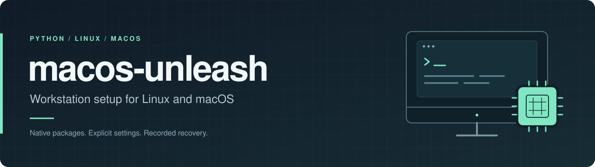
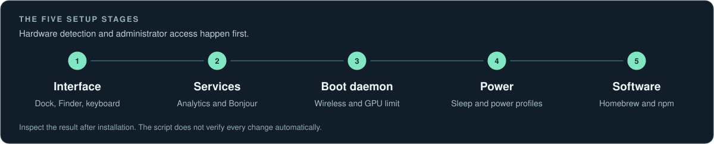
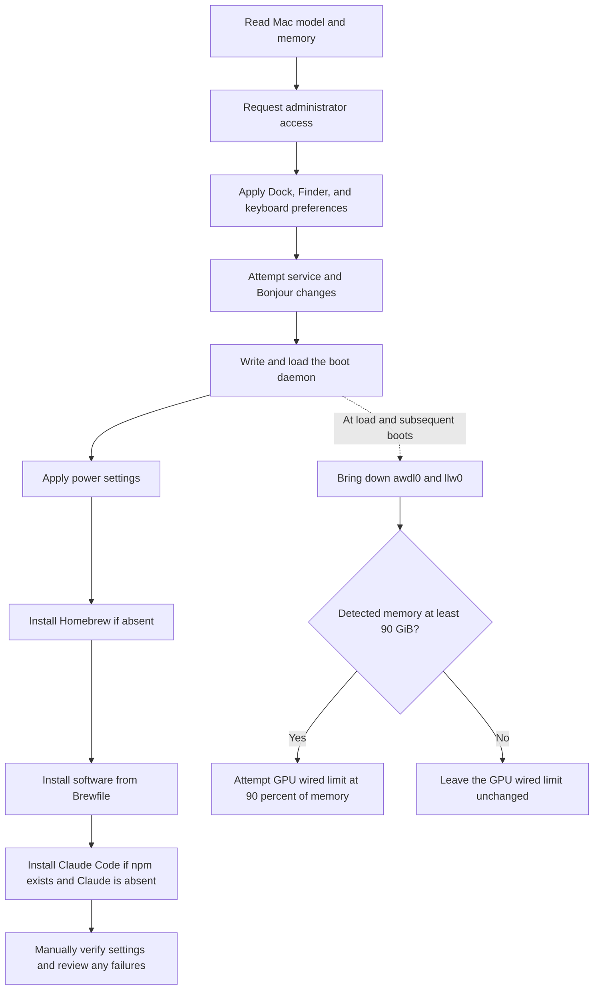

<p align="center">
  
</p>

<p align="center">
  <a href="#requirements"></a>
  <a href="unleash-mac.sh"></a>
  <a href="Brewfile"></a>
  <a href="docs/AUDIT.md"></a>
</p>

<p align="center">
  Configure desktop preferences, system settings, and a development software collection from one Bash script.
</p>

<p align="center">
  <a href="#get-started">Get started</a> &nbsp; / &nbsp;
  <a href="#how-it-works">How it works</a> &nbsp; / &nbsp;
  <a href="#software-collection">Software</a> &nbsp; / &nbsp;
  <a href="docs/TROUBLESHOOTING.md">Troubleshooting</a> &nbsp; / &nbsp;
  <a href="docs/AUDIT.md">Audit</a>
</p>

## At a glance

| Desktop | System | Software |
| --- | --- | --- |
| Dock, Finder, animations, keyboard repeat. | Services, wireless, GPU memory, power. | CLI tools, runtimes, editors, local AI. |

All settings are visible in [`unleash-mac.sh`](unleash-mac.sh). The software list lives in [`Brewfile`](Brewfile).

> [!IMPORTANT]
> This script changes system settings with administrator access. It can affect AirDrop, device discovery, sleep behavior, and memory available to applications. It has no dry run or automatic rollback. Read [what changes](#what-changes) and the [recovery guide](docs/TROUBLESHOOTING.md#recovery) before running it.

## Get started

### Requirements

You need an Apple Silicon Mac running macOS, Bash, administrator access, Apple Command Line Tools, and an internet connection.

<details>
<summary>Full requirements and compatibility notes</summary>

| Requirement | Details |
| --- | --- |
| Operating system | macOS on Apple Silicon. Linux and Windows are not supported. |
| Account | A normal user account with permission to run `sudo`. Do not run the entire script as root. |
| Shell | Bash. Run the script with `bash`, even if your login shell is Zsh. |
| Developer tools | Git and Apple Command Line Tools for Homebrew. |
| Network | Access to GitHub, Homebrew, npm, and the download sites used by the selected applications. |
| Storage | Enough space for the applications in `Brewfile`. The collection includes several browsers, editors, and terminal applications. |

No project API key is required to run the bootstrap. Installed applications may need their own accounts or configuration later. There is no published macOS compatibility matrix; individual preferences and `sysctl` keys can vary by release.

</details>

### 1. Prepare your Mac

Back up important data. Record your existing power settings and any preferences you intend to restore. The [recovery guide](docs/TROUBLESHOOTING.md#recovery) explains what the script does and does not preserve.

Check the platform and developer tools:

```bash
uname -s
uname -m
xcode-select -p
```

The first two commands should report `Darwin` and `arm64` in a native Apple Silicon terminal. If Command Line Tools are missing, run `xcode-select --install` and finish the installation before continuing.

### 2. Download and review

```bash
git clone https://github.com/rod97-1/macos-unleash.git
cd macos-unleash
less unleash-mac.sh
cat Brewfile
bash -n unleash-mac.sh
```

Review the software list before installing. You can edit your local `Brewfile` to remove applications you do not want. This does not disable the system changes in the script.

### 3. Run

```bash
bash unleash-mac.sh
```

Run from an interactive terminal and stay available for the administrator password and installer prompts. If Homebrew is missing, the script downloads and runs its official installer. Homebrew installs the packages and applications listed in `Brewfile`. If npm is available and the `claude` command is absent, the script also installs `@anthropic-ai/claude-code` globally.

The script stops on many command failures, but deliberately ignores some service errors. The final message does not prove that every setting took effect. Use the checks below.

## How it works



Runs in order: interface preferences, services, boot daemon, power settings, then software installation.

<details>
<summary>View the detailed execution flow</summary>




</details>

## What changes

<details>
<summary>View every system change and its limitations</summary>

| Area | Current behavior |
| --- | --- |
| Interface | Disables selected animations, changes Dock timing, adjusts keyboard repeat, and disables App Nap through a global preference. Restarts Dock and Finder. |
| Background services | Attempts to disable `analyticsd` and `diagnosticd`. Errors from these commands are ignored. This does not establish that all telemetry is disabled. |
| Bonjour | Sets `NoMulticastAdvertisements` in the system mDNSResponder preferences and attempts to reload the service. |
| Wireless interfaces | Brings `awdl0` and `llw0` down when the launch daemon runs. The daemon is not a continuous monitor. |
| GPU memory | At a detected whole-number memory size of at least 90 GiB, attempts to set `iogpu.wired_limit_mb` to 90% of that size. This changes a limit; it does not allocate or reserve that amount of memory immediately. |
| Power | Applies one profile when the reported model contains `Mac Studio`; applies separate charger and battery profiles otherwise. Unsupported options can fail. |
| Shell configuration | When installing Homebrew, can append its `shellenv` initialization to `~/.zprofile`. |
| Software | Installs the contents of `Brewfile` and conditionally installs Claude Code through npm. Versions are not pinned. |

The GPU setting uses an OS-specific key. A large wired memory limit can reduce memory available to the rest of the system under load. There is no workload measurement or memory pressure check in the script.

</details>

## Software collection

The collection covers a complete development workstation. Review [`Brewfile`](Brewfile) and remove entries you do not want before installation.

<details>
<summary>Browse the included tools and applications</summary>

| Group | Software |
| --- | --- |
| Command line tools | Git, GitHub CLI, curl, wget, btop, htop, tmux, jq, fzf, ripgrep, tree |
| Development runtimes | Node.js, Python 3.12, Bun, uv |
| Local AI | Ollama; Claude Code is installed separately when the script's conditions are met |
| Development applications | OrbStack, Cursor, Visual Studio Code |
| Terminals | Ghostty, iTerm2 |
| Browsers | Chrome, Firefox, Brave, Zen |
| Utilities | Tailscale, Raycast, BetterDisplay, Syncthing, VLC, AppCleaner |

</details>

Installing an application does not configure it. The script does not download AI models, authenticate applications, or explicitly start Ollama or other application services.

## Verify the result

Run these commands on the target Mac after installation:

```bash
# Confirm the software collection is installed.
brew bundle check --file=Brewfile

# Check the generated plist and inspect the daemon's last result.
plutil -lint /Library/LaunchDaemons/com.custom.unleash.plist
sudo launchctl print system/com.custom.unleash

# Inspect the active power settings and GPU limit.
pmset -g custom
sysctl iogpu.wired_limit_mb

# Inspect the wireless interface flags.
ifconfig awdl0
ifconfig llw0

# Inspect one preference and the Bonjour setting.
defaults read com.apple.dock autohide-delay
sudo defaults read /Library/Preferences/com.apple.mDNSResponder.plist NoMulticastAdvertisements
```

The daemon performs a short task, so it does not need to remain running. Inspect its last exit status and the resulting settings. A missing interface or GPU key is a compatibility issue to investigate. See [troubleshooting](docs/TROUBLESHOOTING.md) for failures and recovery.

## Repository

```text
macos-unleash/
├── README.md                 Project overview and setup
├── unleash-mac.sh            System configuration and installation
├── Brewfile                  Homebrew software collection
├── assets/
│   ├── banner.svg            Project banner
│   └── workflow.svg          Setup overview
└── docs/
    ├── TROUBLESHOOTING.md    Diagnosis and partial recovery
    └── AUDIT.md              Reviewed limitations and follow-up work
```

## Development and project status

Performance depends on the macOS version, hardware, and workload. This project does not include benchmarks or guarantee better responsiveness.

The repository currently has no automated runtime tests or CI workflow. A portable syntax check is:

```bash
bash -n unleash-mac.sh
git diff --check
```

These checks can run on Linux, but they do not validate macOS behavior. Runtime testing needs a suitable Mac and a way to restore its previous configuration.

The [project audit](docs/AUDIT.md) records current reliability gaps and recommended work. When proposing a change, describe the macOS version, how it was checked, and how to reverse it. Remove serial numbers, hostnames, account names, and other personal details from shared diagnostics.

For a problem with installation or recovery, start with the [troubleshooting guide](docs/TROUBLESHOOTING.md). If it does not resolve the issue, [open an issue](https://github.com/rod97-1/macos-unleash/issues) with the macOS version, failing stage, and relevant error text.

No license file is currently included. The maintainer needs to choose a license before contributors can rely on explicit reuse terms.
