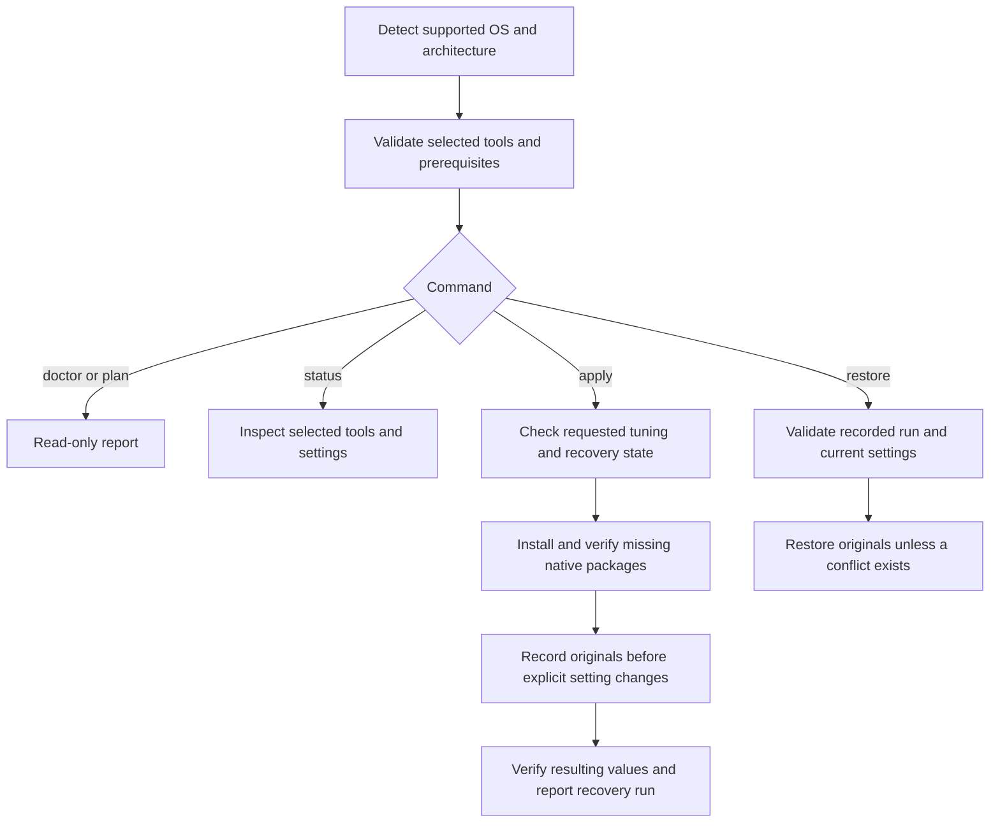

<p align="center">
  
</p>

<p align="center">
  <a href="docs/LINUX.md"></a>
  <a href="docs/MACOS.md"></a>
  <a href="unleash.py"></a>
  <a href="docs/AUDIT.md"></a>
</p>

<p align="center">
  One Python launcher for workstation tools and explicit, recoverable system settings.
</p>

<p align="center">
  <a href="#get-started">Get started</a> &nbsp; / &nbsp;
  <a href="#how-it-works">How it works</a> &nbsp; / &nbsp;
  <a href="#tool-profiles">Tools</a> &nbsp; / &nbsp;
  <a href="docs/TROUBLESHOOTING.md">Troubleshooting</a> &nbsp; / &nbsp;
  <a href="docs/AUDIT.md">Audit</a>
</p>

## At a glance

| Tools | System settings | Recovery |
| --- | --- | --- |
| Native APT, DNF, and Homebrew packages. | Explicit choices with capability checks. | Original setting values recorded before changes. |

The project started as a Mac bootstrap. The shared launcher now handles Ubuntu, Debian, Fedora, and Apple Silicon macOS through native adapters. Windows is deferred until the Linux milestone is complete.

> [!IMPORTANT]
> `plan` changes nothing. `apply` installs the selected packages and applies only the tuning you request. Recovery covers recorded settings, not package removal or unrelated user changes. Some settings need administrator access and can affect power use or desktop behavior.

## Get started

You need Python 3.10 or newer and your platform's package manager. The launcher has **no third-party Python dependencies**.

| Platform | Package manager | Validation |
| --- | --- | --- |
| Ubuntu | APT | Core/dev installation and repeat runs tested on Ubuntu 24.04 x86_64. |
| Debian | APT | Core/dev installation and repeat runs tested on Debian 13 x86_64. |
| Fedora | DNF | Core/dev installation and repeat runs tested on Fedora 44 x86_64. |
| Apple Silicon macOS | Homebrew | Unit suite and native read-only doctor/plan checks pass in CI; physical tuning still needs verification. |
| Windows | Not implemented | Planned after Linux; the launcher rejects Windows without changes. |

Linux detection accepts x86_64 and arm64. The native package integration checks currently cover x86_64. See [Linux prerequisites](docs/LINUX.md) or [Mac prerequisites and migration](docs/MACOS.md).

### 1. Inspect and plan

```bash
git clone https://github.com/rod97-1/macos-unleash.git
cd macos-unleash
python3 unleash.py doctor
python3 unleash.py plan --profile core --profile dev
```

`doctor` checks prerequisites. The plan lists selected tools, missing packages, exact installation commands, and any manual prerequisites. Neither command installs packages, elevates privileges, or creates recovery state.

### 2. Apply the selection

```bash
python3 unleash.py apply --profile core --profile dev
python3 unleash.py status --profile core --profile dev
```

Run as your normal user. On Linux, system package installation uses `sudo` when needed; the entire launcher does not need to run as root. No system upgrades, remote installation scripts, or third-party repositories are added. An installer failure stops the run and returns a nonzero exit code.

Package presence is checked through the native package manager. A separately installed executable may still appear missing if the selected distro package is absent. Tools without a native mapping are checked by their executable instead.

### 3. Select only what you need

```bash
# Just two tools, without implicitly adding the core profile.
python3 unleash.py plan --tool git --tool jq

# Exclude an entry from a profile.
python3 unleash.py plan --profile core --exclude htop

# Inspect optional local AI tooling.
python3 unleash.py plan --profile ai
```

An unavailable external tool is shown as a manual prerequisite, with its official documentation. `apply` stops before package installation until those prerequisites are installed or excluded. The launcher does not download models, authenticate applications, or start AI servers.

## How it works


Inspect, plan, apply, and check status. Restore is available for recorded settings when needed.

<details>
<summary>View the execution flow</summary>



</details>

## Tool profiles

Profiles can be combined. Without a profile or individual tool selection, the launcher selects `core`. Use `--tool` and `--exclude` to customize the selection.

Tool IDs are the labels printed by the plan, such as `python`, `node`, and `syncthing`. Use `plan --profile full` to inspect the original collection without installing it.

| Profile | Included tools |
| --- | --- |
| `core` | Git, curl, wget, btop, htop, tmux, jq, fzf, ripgrep, tree. |
| `dev` | GitHub CLI, Node.js and npm, Python and pip; APT also installs venv support. |
| `desktop` | Firefox, Syncthing, VLC. Ubuntu Firefox is a manual prerequisite; exclude it if managed separately. |
| `ai` | Ollama. Homebrew installs it on Mac; Linux requires an existing official installation. |
| `full` | The original Mac Homebrew collection. Several entries require manual installation or have no Linux equivalent. |

<details>
<summary>Browse the full Mac collection and optional tools</summary>

[`Brewfile`](Brewfile) remains independently usable. The catalog test checks that its 31 entries match the `full` Mac profile.

| Group | Software |
| --- | --- |
| Command line | Git, GitHub CLI, curl, wget, btop, htop, tmux, jq, fzf, ripgrep, tree. |
| Runtimes | Node.js, Python 3.12, Bun, uv. |
| Local AI | Ollama. |
| Development | OrbStack, Cursor, Visual Studio Code. |
| Terminals | Ghostty, iTerm2. |
| Browsers | Chrome, Firefox, Brave, Zen. |
| Utilities | Tailscale, Raycast, BetterDisplay, Syncthing, VLC, AppCleaner. |

Claude Code can be inspected with `--tool claude` after a separate installation. It is not included in any default profile. Bun and uv also need separate Linux installation. See the [Linux tool support guide](docs/LINUX.md#tool-availability).

</details>

## Optional system settings

Package installation does not imply tuning. Preview settings separately with `--no-packages`:

```bash
python3 unleash.py plan --no-packages --tune desktop
python3 unleash.py apply --no-packages --tune desktop
python3 unleash.py status --no-packages --tune desktop
```

| Choice | Linux | macOS |
| --- | --- | --- |
| `--tune desktop` | Disable GNOME animations in an active writable user session. | Dock, Finder, keyboard repeat, and selected global preferences. |
| `--tune power` | Select performance only when powerprofilesctl exposes that profile. | Charger sleep disabled; charger display sleep set to 20 minutes. Battery settings are preserved. |
| `--tune services` | Not supported. | Explicit analytics/diagnostic disabling overrides and Bonjour advertising preference. |
| `--tune wireless` | Not supported. | Bring awdl0 and llw0 down for the current session; affects AirDrop. |
| `--gpu-limit-mb VALUE` | Not supported. | Explicit GPU wired limit, validated against memory and OS support. |

No boot daemon is created. No GPU memory, wireless, kernel, or security changes are copied to Linux. Unsupported tuning requests fail before package installation. Written values are checked; actual performance is not benchmarked or guaranteed.

## Restore recorded settings

Each setting run prints a recovery ID. State is private to the current user and platform.

```bash
# Preview the help, then restore the latest recorded setting run.
python3 unleash.py restore --help
python3 unleash.py restore

# Restore a specific run printed by apply.
python3 unleash.py restore --run RUN_ID
```

Linux state lives under `${XDG_STATE_HOME:-~/.local/state}/macos-unleash`. Mac state lives under `~/Library/Application Support/macos-unleash`. Use the same `--state-dir` for plan/apply/status/restore if you override it.

Restore stops when a managed value has been changed outside the launcher. Repeated apply retains the original baseline. Recovery never uninstalls packages, deletes models, undoes application authentication, or restores settings changed by the old Bash-only script. Read the [recovery and migration guide](docs/TROUBLESHOOTING.md#recovery) before relying on it.

## Repository

```text
macos-unleash/
├── unleash.py               Shared Python entry point
├── unleashlib/              Platform adapters, catalog, execution, recovery
├── unleash-mac.sh           Mac compatibility entry point
├── Brewfile                 Original Mac software collection
├── tests/                   Unit and disposable Linux integration checks
├── .github/workflows/       Linux and macOS CI
├── assets/                  Banner and workflow graphics
└── docs/                    Platform guides, troubleshooting, audit, design
```

## Development

```bash
python3 -m unittest discover -s tests -v
python3 -m compileall -q unleash.py unleashlib tests
bash -n unleash-mac.sh tests/integration-linux.sh
git diff --check
```

The unit suite uses temporary state and injected command runners. Native Linux package checks run in disposable containers. Mocked desktop and Mac tests do not establish native tuning behavior. See [the audit](docs/AUDIT.md) for evidence and remaining limitations.

For problems, start with [troubleshooting](docs/TROUBLESHOOTING.md), then [open an issue](https://github.com/rod97-1/macos-unleash/issues) with the command, OS version, and relevant error. Remove serial numbers, hostnames, account names, and credentials from diagnostics.

No license file is currently included. The maintainer needs to choose reuse terms before a licensed release.
